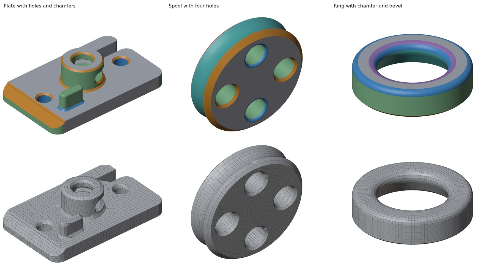
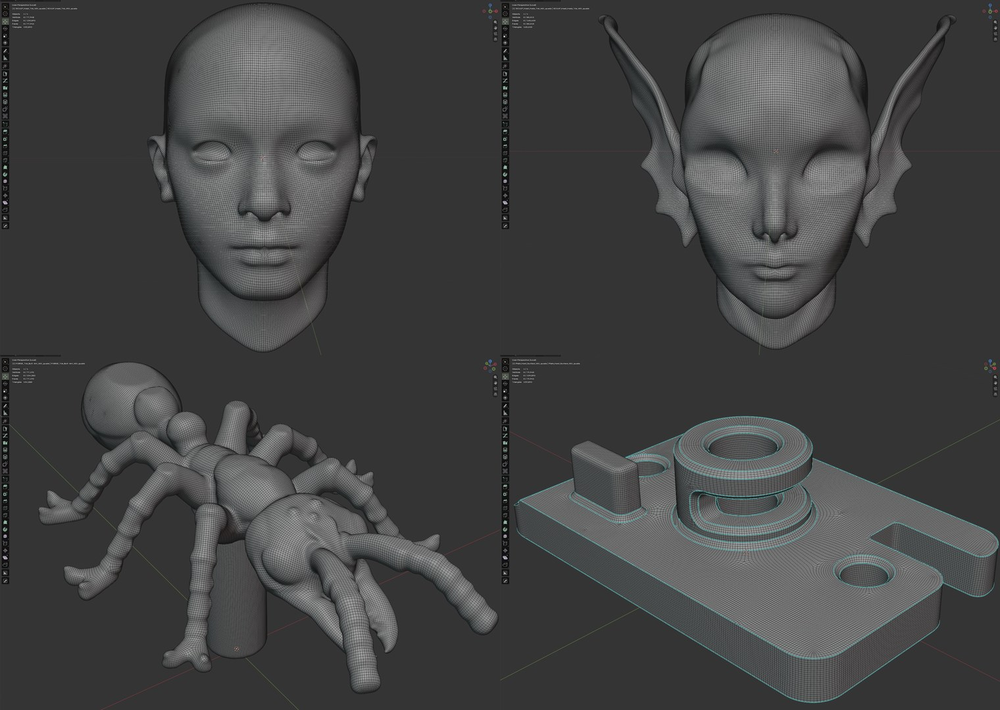
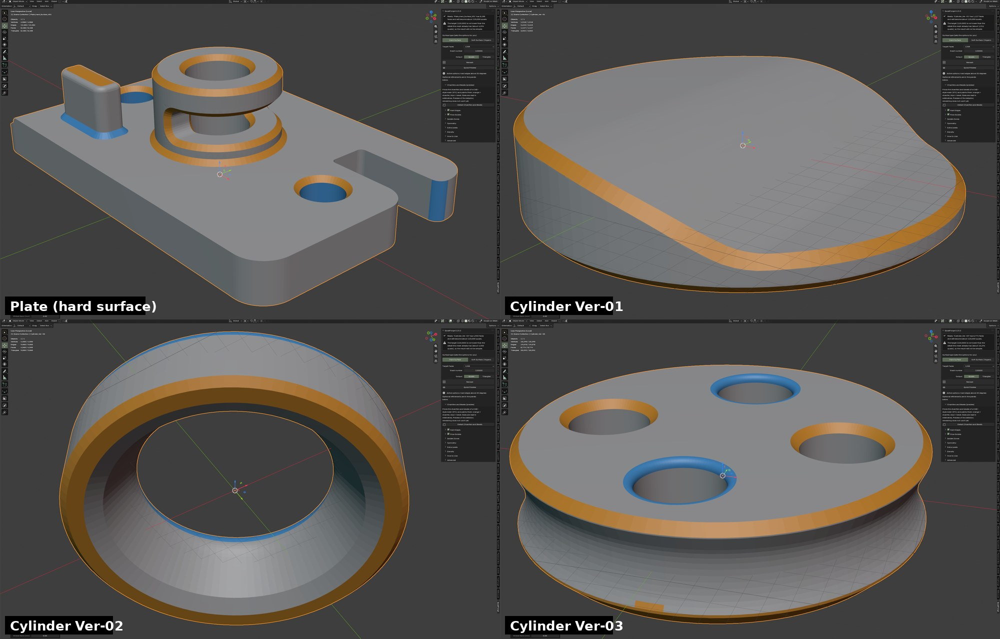

# QuadForge

A Blender add-on for fast quad and triangle remeshing, powered by **FORGE**, its own engine written in Rust. Version **0.16.4**.
It handles organic sculpts and, in preview, CAD / STL parts (3D printing, mechanical): it can split a whole model into surfaces and keep chamfers, bevels and borders.

Screenshots come from runs in Blender 5.2.3 on the author's machine; times depend on the computer.

- Quads or triangles, from 2K to 500K faces, with a one-click **Hard Surface** (flat shading, CAD surface analysis) / **Soft Surface (Organic)** (smooth shading) setup
- Reads heavy sculpts directly, keeps hard edges, symmetry, UV maps, Face Sets and materials
- Isolate zones by material, Face Set, mask or vertex group
- Paintable density through a vertex group; smaller faces on thin parts and, optionally, on strongly curved details
- Quick Preview before the full run, detail per zone, and an option that makes the result match your sculpt after Subdivision Surface
- **Surface analysis, chamfers and bevels (preview, 0.15 / 0.16):** splits a CAD / STL part into planes, cylinders, spheres, cones, revolution surfaces, chamfers and bevels, paints them, and lets the Hard Surface remesh keep their borders; see [below](#surface-analysis-chamfers-and-bevels-preview)
- Exact symmetry (no open seam), several levels of detail in one run, cancel with Esc
- English and Spanish interface
- Blender 4.2 or newer (developed and tested on Blender 5.2). GPL-3.0-or-later.

## Install

Download the zip for your system from the **Releases** page, then in Blender:
`Edit > Preferences > Get Extensions > ▾ > Install from Disk…`

The panel appears in the 3D Viewport sidebar (**N**), **QuadForge** tab.

## How it works

Many people ask how a quad remesher actually works, because the tools rarely explain themselves. FORGE follows the
standard modern recipe for field-aligned quad meshing, written from scratch as a dependency-free
Rust program (`engine-rs/`; it was C++17 until 0.14, see the changelog). In short:

1. **Prepare (Python, in Blender).** The add-on reads the mesh and decides the constraints: hard edges found as
   *chains* of sharp edges (so noise is ignored and real creases are kept), zone borders, the symmetry plane, painted
   density and flow guides. With the **Hard Surface** button it also runs the **surface analysis** (next section): the
   engine splits the CAD mesh into planes, cylinders, spheres, cones, chamfers and bevels, and the borders between them
   (and the two sides of every chamfer or bevel wide enough for a row of quads) are added to the hard edges. Everything
   is written to a small binary file and the engine starts as a separate process, so a failure can never crash
   Blender and Esc simply stops it.
2. **Repair and resample.** The engine makes the mesh manifold, closes open borders with temporary caps, and remeshes it
   into a uniform triangle mesh (isotropic remeshing, after Botsch and Kobbelt) with about six triangles per future quad
   cell. A size field makes the triangles smaller where the shape is thin or strongly curved.
3. **Choose where the rows run: the cross field.** A smooth field of four orthogonal directions is computed on every
   face by minimising a Dirichlet-like energy on the complex number *z = exp(4iθ)*. Creases and borders fix it; the
   smoothest field is found by inverse iteration. The singularities of this field are exactly where the irregular
   vertices (poles) of the final mesh will be.
4. **Unfold into a square grid: integer-grid parametrization.** The surface is cut along a graph that ends at the
   singularities and mapped to the plane so that the field becomes the grid directions. The map is found by a sparse
   least-squares solve; the translations across cuts and the singular points are then rounded to integers gradually,
   re-solving as it goes. The integer lines *u = k* and *v = k* are the quad edges. If a strong size variation keeps
   the solve from improving, the engine gives up early instead of retrying for many seconds.
5. **Extract and refine.** Each vertex snaps to its nearest lattice node, vertices that land on the same node merge
   into a cell, and faces are traced around the cell graph. Every cell is split 2×2, relaxed on the surface, snapped to
   the marked creases, and the worst quads are repaired. The lattice spacing is corrected up to three times to land
   within a few percent of the requested count.
6. **Finish (Python).** Sliver quads on thin bevels are collapsed, neighbouring leftover triangles are joined into quads
   (Hard Surface), the symmetry cut is mirrored and welded, and UV maps, Face Sets, mask and materials are carried
   over. Last comes the **shading**: **Hard Surface** leaves the result **Flat**, so no smoothing changes the look of
   the surface; **Soft Surface / Organic** shades it **Smooth**. You can change it in Advanced.

If the grid method fails for a shape (an unclosable border, a size gradient the surface cannot follow, the time limit),
the engine falls back to a **triangle-pairing** method and tells you why. FORGE is a heuristic: it prefers to report a
problem or fall back rather than return an invalid mesh.

### Read more

| Document | For |
|---|---|
| [**Technical report**](docs/TECHNICAL_REPORT.md) | The method in depth: equations, algorithms, evaluation against Blender's QuadriFlow and Decimate, limitations, how FORGE differs from the published methods, and references |
| [**Architecture for AI assistants**](docs/ARCHITECTURE_FOR_AI.md) | A dense, exact map of the code for any AI (or contributor) that needs to understand or change it: file map, data flow, formats, decision flow, invariants, tests |
| [User guide](quadforge/docs/USER_GUIDE.md) | Using the add-on |
| [Surface analysis](quadforge/docs/SURFACE_ANALYSIS.md) | Whole-model surfaces, borders and how the remesh uses them |
| [Chamfer and bevel detector](quadforge/docs/CHAMFER_BEVEL_DETECTOR.md) | What the 0.15 detector does, how it works, its command line and limits |
| [Testing guide](docs/TESTING_GUIDE.md) | A 30-minute checklist for people trying the add-on on their own machine and models |
| [Status and limits](quadforge/docs/STATUS_AND_LIMITS.md) | What is tested, measured and not done yet |
| [Changelog](quadforge/CHANGELOG.md) | Version history |

This is not a peer-reviewed paper and makes no claim of a new algorithm: it is an engineering implementation of
published ideas ([references in the report](docs/TECHNICAL_REPORT.md#11-references)). If you use it in research,
GitHub's **Cite this repository** button uses [`CITATION.cff`](CITATION.cff).

## Surface analysis, chamfers and bevels (preview)

For CAD-style meshes (triangulated STL, mostly 3D printing, millimetres) **Analyze Surfaces** splits the whole model into planes, cylinders, spheres, cones, surfaces of revolution and free-form patches and lists the borders between them; the **Hard Surface** remesh can use it to keep the real limits of every wall (experimental option). The same engine finds the small transition
faces between big surfaces and tell them apart: **orange = chamfer** (flat), **blue = bevel / fillet** (curved). The
table of widths, lengths, turn angles and radii is written to a text datablock, and every face gets a `qf_band`
attribute. It is a preview: the *Use Surface Analysis* option of the remesh (on with the **Hard Surface** button) keeps the borders of every surface and both sides of chamfers and bevels wide enough for the quads to follow, so the quad rows follow the real limits of the walls. Compare the result with it on and off; about 2 % of the faces can stay triangles.

Details: [`SURFACE_ANALYSIS.md`](quadforge/docs/SURFACE_ANALYSIS.md) and [`CHAMFER_BEVEL_DETECTOR.md`](quadforge/docs/CHAMFER_BEVEL_DETECTOR.md).

## Measured quality

Against Blender's built-in QuadriFlow at 20,000 faces on five sculpts (two CPU cores): better squares (scaled
Jacobian) on four of five models, the requested face count hit more closely, and faster on three of five. QuadriFlow
still produces fewer irregular vertices at 80,000 faces and above. Triangle output follows the surface about twice as
closely as Decimate, with near-equilateral triangles. The full tables, the metric definitions and a reproducible check
on meshes you can regenerate are in the [technical report](docs/TECHNICAL_REPORT.md#7-evaluation).

## Status

The FORGE engine is validated most on Linux with Blender 5.2. Engines for Windows and macOS (Intel and Apple Silicon)
are built by the CI workflow and pass the engine tests there, but have had little real-world use: please open an issue
if something fails. The chamfer/bevel detector and the surface analysis (0.15.x / 0.16.x) are in the Linux engine checked into the repository; Windows and macOS get them from releases built by CI.

## Folders

- `quadforge/` the add-on (Python) and its documentation
- `engine-rs/` the FORGE engine source (Rust, no dependencies; `engine-rs/README.md` maps every work area to its file)
- `engine/` the original C++17 engine (used until 0.14), kept as a reference only (not shipped, no chamfer detector)
- `docs/` technical report, architecture for AI assistants, figures
- `tests/`, `tools/` tests, build scripts and quality metrics

## License

GPL-3.0-or-later. See `LICENSE`.
