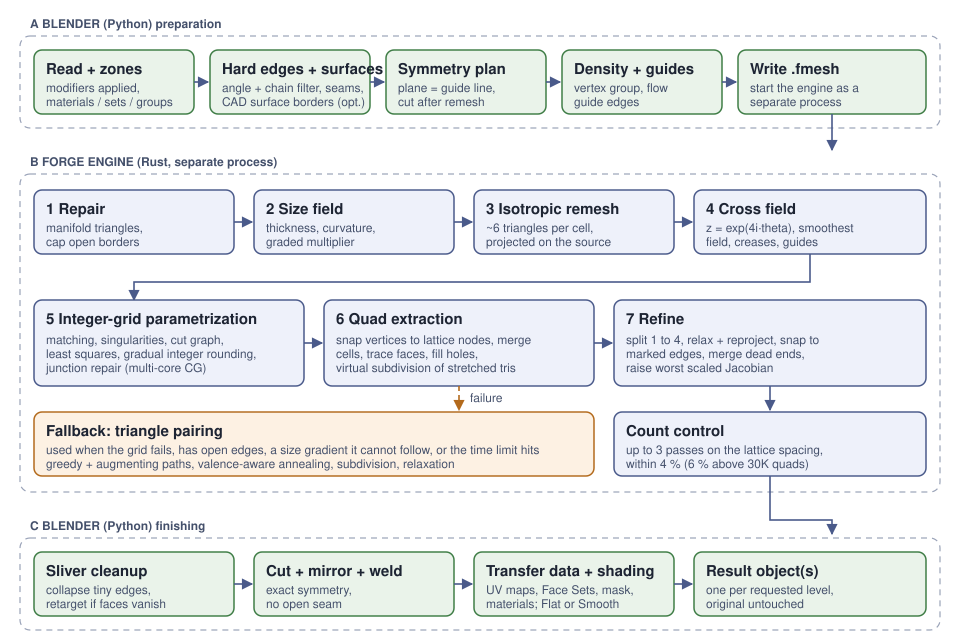

# FORGE: field-aligned integer-grid quad remeshing inside Blender

**Technical report for QuadForge Vivaldi 0.12.0** · GPL-3.0-or-later · November 2026

> **What this document is.** A description of how the QuadForge add-on and its FORGE engine turn an arbitrary triangle or
> polygon mesh into a clean quad mesh. It is a **technical report, not a peer-reviewed paper**. FORGE does not claim a new
> algorithm: it assembles well-known published techniques (isotropic remeshing, 4-direction cross fields, seamless
> integer-grid parametrization) into a compact C++17 program and adds a layer of practical engineering around them.
> Every statement below was checked against the source code in this repository. Where FORGE is simpler than the
> published method it borrows from, that is said explicitly (see [section 9](#9-how-forge-differs-from-the-published-methods)).
>
> A version of this document written for AI assistants and code readers is in [`ARCHITECTURE_FOR_AI.md`](ARCHITECTURE_FOR_AI.md).

## Contents

1. [The problem](#1-the-problem)
2. [Overview](#2-overview)
3. [Stage A: preparation in Blender (Python)](#3-stage-a-preparation-in-blender-python)
4. [Stage B: the FORGE engine (C++)](#4-stage-b-the-forge-engine-c)
5. [Stage C: finishing in Blender (Python)](#5-stage-c-finishing-in-blender-python)
6. [The fallback path: triangle pairing](#6-the-fallback-path-triangle-pairing)
7. [Evaluation](#7-evaluation)
8. [Limitations and known failure modes](#8-limitations-and-known-failure-modes)
9. [How FORGE differs from the published methods](#9-how-forge-differs-from-the-published-methods)
10. [Reproducing everything](#10-reproducing-everything)
11. [References](#11-references)

---

## 1. The problem

Sculpts, scans and photogrammetry meshes are made of millions of irregular triangles. Artists need a **quad mesh** with
far fewer faces whose rows of quads ("edge flow") follow the shape: around eyes and mouths, along limbs, along the
creases of a mechanical part. Such a mesh deforms well, subdivides well, UV-unwraps well and can be edited by hand.

A good quad mesh is mostly made of *regular* vertices (valence 4). Where the surface forces it, a few *irregular*
vertices ("poles", valence 3 or 5) remain. The topology theory behind this is the following: if you choose a
direction field on the surface that has rotational symmetry of order 4, the singularities of that field are exactly
where the poles must sit. Everything FORGE does is organised around that idea:

1. choose where the quad rows should run (a **cross field**),
2. unfold the surface onto a plane in which those rows become the horizontal and vertical lines of a square grid
   (an **integer-grid parametrization**),
3. cut the surface along the integer lines (**quad extraction**),
4. clean up.

The survey by Bommes et al. [4] describes this family of methods in depth; this report assumes no prior knowledge
and explains each step.

## 2. Overview



The add-on is split into two processes:

| Part | Language | Runs in | Job |
|---|---|---|---|
| **QuadForge** (`quadforge/`) | Python (+ NumPy, `bmesh`) | Blender | Reads the mesh, decides constraints (hard edges, zones, symmetry, density), launches the engine, builds the result objects |
| **FORGE** (`engine/src/`) | C++17, no dependencies | A separate process | Repairs the mesh, remeshes it isotropically, computes the field and the parametrization, extracts the quads |

The two talk through a small binary file format (`.fmesh`) and a line-based text protocol on the engine's
standard output. Because the engine is a separate process, a crash in it cannot close Blender, and pressing Esc simply
kills the process.

Notation used below: *N* is the requested number of quads, *A* the surface area, *ρ* the lattice spacing (the edge
length of one cell of the square grid in the parametrization) and *L* the target edge length of the isotropic
triangle mesh.

## 3. Stage A: preparation in Blender (Python)

Source: `quadforge/core/pipeline.py` (`run_steps`), `features.py`, `symmetry.py`, `geometry.py`.

### 3.1 Reading the source and zones

The evaluated mesh (modifiers applied) is copied; the original object is never modified. A BVH tree of the original
surface is built once and reused for projection and symmetry checks. **Zones** are optional regions that must stay
separate in the result. They can come from materials, sculpt Face Sets, the sculpt mask, or vertex groups (the weight
of a face is the mean of its vertex weights, the zone is the group with the largest weight, and faces below a cut-off
belong to no zone). The border between two zones becomes a set of hard edges (section 3.2).

### 3.2 Hard edges: chains, not single edges

A naive rule "mark every edge whose dihedral angle exceeds a threshold" has two weaknesses on real models: noise
produces many tiny isolated "hard" edges that a quad mesh can never follow, and a feature shorter than about two
target quads cannot be represented however sharp it is. `features.py` therefore reasons about **chains** of connected
candidate edges:

* the dihedral angle of every edge is computed from the face normals;
* connected candidate edges form chains (connected components);
* a chain is kept if it contains at least one *strong* edge (above the user's angle) **and** its length is at least
  `min_chain_quads` target edge lengths (default 2), where the target edge length is $\ell = \sqrt{A/N}$;
* optionally, a chain that is mostly made of near-right angles (70°–110°, at least half of its edges) is kept down to
  one target edge length, because such short runs (the rim of a peg, a box corner) define the shape.

On a 37K-triangle test model with a 20K-quad target the chain filter dropped 55 % of the chains but only about 7 % of
the edges: real creases survive, isolated noise disappears. Material seams, existing "sharp" marks, UV seams and zone
borders can be added to the hard edges as well. If more than 25 % of the edges end up hard, the user is warned that
the angle is probably too low.

### 3.3 Symmetry

Symmetry is **exact by construction**. For a closed model and quad output (the common case), FORGE remeshes the
*whole* model with the symmetry plane inserted as a line of marked edges (a "guide line" the quad rows will align to),
then cuts the result at the plane, keeps one half, mirrors it and welds the seam. Because the quad rows run along the
plane, the cut passes between rows of quads instead of through them. Open models, triangle output and the QuadriFlow
backend use the older route: cut first, remesh one half with its border fixed, mirror, weld.

Details that matter in practice: vertices within a tolerance of the plane are snapped onto it; quads lying flat on the
plane, pinched quads with three vertices on the plane and thin folded flaps are removed before mirroring (they would
create non-manifold edges); holes left by that are filled after the mirror. A diagnostic estimates how symmetric the
input really is by mirroring 2000 random vertices and measuring their distance to the surface; if fewer than 90 %
match, the user is warned that mirroring will change the shape.

### 3.4 Density and flow guides

A vertex group can ask for smaller faces. The group weight *w* ∈ [0,1] becomes a per-vertex edge-length multiplier

$$ s = \frac{1}{1 + (r-1)\,w} $$

where *r* is the user's "detail ratio": *s* = 1 where *w* = 0 (normal size) and *s* = 1/*r* where *w* = 1.

The same multiplier carries the per-zone detail factors: a zone with factor *k* gets *s* = 1/*k*, a vertex on a zone
border takes the finer side, and log *s* is then diffused over a few hundred Jacobi steps (about eight quad cells), because
the engine's parametrization follows a gradual change but gives up on a sudden jump at a constrained border. Even so,
the integer-grid fit limits the effect: a factor of 2 (edges half as long) produced about 1.7 times more faces in the
zone on the test sphere, not 4. The engine accepts a density power when its fit error is within 12 % + 0.02 of the plain
fit, instead of the absolute 0.45 limit alone, since models with many constrained borders already sit near that limit.

Edges the
user marked as flow guides are passed to the engine as line segments; they pull the cross field (section 4.4) as a
soft hint, never as a hard constraint.

### 3.5 Sending the mesh

Positions, polygons, hard-edge vertex pairs, the density multiplier and the guide segments are written to a `.fmesh`
file (little-endian: magic `FMSH`, version 1, counts, float32 positions, polygon sizes and indices, hard-edge pairs, and
optional density and guide blocks selected by flags). The engine is launched with `--faces N --mode quad`.

## 4. Stage B: the FORGE engine (C++)

Source: `engine/src/` (about 5,500 lines). The control flow is in `main.cpp`.

### 4.1 Repair

`repair.hpp` turns arbitrary polygon soup into a valid manifold triangle mesh: it triangulates (quads along the
shorter diagonal), drops faces that repeat a vertex and exact duplicates, orients every connected piece consistently,
unlinks non-manifold edges (they become open borders, which are preserved), duplicates pinched vertices so each vertex
has a single fan of faces, and removes unused vertices. A JSON report of what was found is sent back. Flat sliver
triangles with all three edges open and collinear vertices (a leftover of a bad weld) are removed because they would
break the grid.

### 4.2 Open borders: capping

The integer-grid machinery wants a closed surface (a closed loop of fixed length cannot hold a non-integer number of
cells). `capping.hpp` closes every boundary loop with a fan of triangles around its centroid:

* loops shorter than about 6 estimated quad edges are simply left closed (the hole disappears);
* longer loops are marked *removable*: their border edges become feature lines the grid aligns to, and the cap triangles
  are labelled. After extraction the quads on the cap are dropped, and very short edges next to the border are welded
  if the result stays manifold.

If the capped extraction ends up more than 25 % away from the requested count, the engine falls back to the pairing
path on the original open mesh.

### 4.3 Size field: thin parts and curved details

Without help, a uniform grid under-resolves thin parts. `sizefield.hpp` computes a per-vertex edge-length multiplier
*s* ∈ [`minScale`, 1] from the geometry:

* **Thickness** with the *shrinking-ball* method: at each vertex, the radius *r* of the largest ball that touches the
  surface there and stays inside the shape is found (half the local thickness of a tube or plate). A tube of radius *a*
  needs about eight quads around it, so the quad edge is limited to `ratio · r` (default ratio 1.3, never finer than
  half the global size). The refinement applies only where the surface is also curved (tubes, not flat walls). For
  dense inputs the ball is measured on a sample of vertices and propagated over the surface. The search starts at radius
  `rho / ratio`, not at the size of the model: a wider ball asks for no refinement, and from a point deep inside a
  ball-like shape every triangle is about equally far, so a BVH cannot prune (this stage took a minute on 80,000
  triangles before; it takes under a second now, with identical results on the test suite).
* **Curvature** (user option "Detail on Curves"): a quad edge should not turn the surface by more than a given angle, so
  the edge length is limited to *angle / curvature* (curvature smoothed over about half a quad so mesh noise does not
  count). This puts smaller faces on eyelids, lips, nostrils and ear rims.
* The result is **graded**: the size never changes faster than a fixed rate per unit of distance
  ($s_i \le s_j + g\,|e_{ij}|/\rho$, with *g* = 0.5), so the mesh does not jump between sizes.

The multiplier is multiplied into any density the user painted.

### 4.4 Isotropic triangle remeshing

`remesh.hpp` implements incremental isotropic remeshing in the style of Botsch and Kobbelt [1]. The initial target edge
length follows from the (density-weighted) surface area and the target triangle count *T*, so that *T* equilateral
triangles would cover the area:

$$ L = \sqrt{\frac{4A}{\sqrt{3}\,T}} $$

Each pass does, in order: split edges longer than 4/3 of the local target length, collapse edges shorter than 4/5
(only if the link condition holds, no triangle flips and no edge grows too long), flip edges toward valence 6
(valence 4 on borders), and smooth tangentially while **projecting every vertex back onto the original surface**
(through a BVH). Vertices on marked edges only slide along their chain. The face count is steered by feedback: after the
main passes, *L* is rescaled by $\sqrt{\text{current}/\text{target}}$ and a correction pass is run until the count is
within 2 %.

For the quad path the triangle mesh is deliberately **finer than the final quad mesh**: it has about 6 triangles per
lattice cell. Marked edges are *not* given to this step in the grid method (they would add poles around them); the
grid is aligned to them in the parametrization instead.

### 4.5 The cross field

`field.hpp` computes a smooth field of four orthogonal directions on every face. A face with local frame (e₁, e₂) is
described by one complex number

$$ z = e^{4i\theta} $$

where θ is the angle of one of the four axes in the frame. Encoding the angle times four removes the four-fold
ambiguity: rotating an axis by 90° gives the same *z*, so no matching between neighbours is needed to *compare* two
fields. Neighbouring faces *f*, *g* are compared after transporting *z* across their shared edge by the unit complex
number $r_{fg}$ (the rotation between the two frames), and the field minimises the Dirichlet-like energy

$$ E = \sum_{(f,g)} w_{fg}\,\bigl| z_g - r_{fg}\, z_f \bigr|^2 $$

with edge weights $w_{fg}$ = edge length / distance between the face centres (so the result does not depend on how
uneven the triangles are). This is the formulation of Knöppel et al. [6] specialised to symmetry order 4 (see also Ray
et al. [5]).

* Faces next to a **marked edge or an open border** are *fixed*: their field must align with the edge direction.
* A connected component with constraints is solved as a plain linear system (conjugate gradient).
* A component **without** constraints has no preferred direction, so the smoothest field is taken: the eigenvector of
  the smallest eigenvalue, found by inverse iteration, each step solved by conjugate gradient.
* Optional soft pulls are added: towards crease directions where the surface bends strongly in one direction only
  (so rows follow the crease and close into loops around an eye), and towards the direction of user flow guides within a
  radius of a few edge lengths. Both fade with distance, and smoothness wins where they contradict the surface.
* For meshes above 12,000 faces the field is solved on a coarser copy (a quarter of the faces, at least 2,000) and
  transferred by closest-face lookup; faces next to marked edges then get their exact alignment back.

### 4.6 Seamless integer-grid parametrization

`param.hpp` is the core of the engine: a compact mixed-integer quadrangulation in the spirit of Bommes et al. [3, 12].
The goal is a map (*u*, *v*) at every triangle corner such that the lines *u* = integer and *v* = integer are the
edges of the quad mesh, one lattice cell per ρ × ρ patch of surface.

1. **Matching and singularities.** Neighbouring faces agree on the four directions up to a rotation by *k*·90°.
   Going around a vertex, the rotations must add up to a multiple of 360°; where they do not, the vertex is a
   **singularity** of the field, and that is where a pole will be.
2. **Gauge and cut graph.** One of the four directions is chosen per face by propagating along a spanning tree of the
   dual graph. The edges across which the choice still jumps by *k* ≠ 0 form the **cut graph**, which ends at the
   singularities. On a surface with handles, a few extra cycles are added so the surface becomes a disc.
3. **Sheets.** Corners around a vertex that are not separated by a cut edge share one (*u*, *v*) pair.
4. **Least squares.** Every face asks for a parametrization gradient equal to the chosen field direction divided by ρ:
   $\nabla u = U/\rho$, $\nabla v = V/\rho$. Across a cut edge, the two sides must agree up to a rotation by *k*·90° and a
   translation *t*: $(u,v)_B = \mathrm{Rot}(k)\,(u,v)_A + t$. The agreement is enforced by a stiff penalty (weight 30 in
   the first solve, 1000 once the singularities are fixed); *t* is a free variable per cut path. Marked edges ask that one
   of the two coordinates stay constant along them, so the grid runs *along* the crease. The size multiplier enters as a
   per-face scale of the target gradient, raised to a "density power" (see 4.8).
5. **Integer rounding.** The translations *t* and the (*u*, *v*) of singular vertices must be integers (a pole sits on a
   lattice node). They are rounded **gradually**: the third of the open variables closest to an integer (plus any within
   0.02) are fixed, the system is solved again, and the process repeats until none are left (the greedy rounding idea
   of [3]). Singular vertices go first, then the translations of paths that end at them, then the remaining paths in
   batches that never contain two paths meeting at a junction.
6. **Junction repair.** A junction of three cut paths needs integer translations that add up to zero. Batch rounding
   can miss this around two neighbouring junctions that share a path, leaving a residual of about one third of a cell
   on every seam there. The solver tries shifting the shared path by one cell, or moving a pole one lattice step along
   with its path, and keeps the variant with the fewest *bad seams* (seam residual above a quarter of a cell).

The linear systems are large, sparse and badly conditioned. They are solved with a Jacobi-preconditioned conjugate
gradient that runs the *entire iteration* on a team of threads with a spinning barrier; rows are split in fixed chunks,
so results are deterministic for a given thread count. A smoothed-aggregation algebraic multigrid preconditioner
([10], `amg.hpp`) is implemented but **off by default**: on current meshes it was slower than Jacobi-CG.
Parametrization time dominates the run at high face counts (see section 8).

### 4.7 Quad extraction

`extract.hpp` turns the (*u*, *v*) map into a polygon mesh. This is **simpler than the exact method of Ebke et al.
[7]** (see section 9):

1. Every mesh vertex is moved to the nearest lattice node of its own (*u*, *v*) (in surface units, using the face's
   field directions).
2. Where the parametrization stretches the grid by several times (finger tips, thin ends), the isotropic mesh has fewer
   vertices than the lattice has nodes and some nodes would get no cell. Triangles with a parameter-space edge longer than
   0.8 of a lattice step are therefore **subdivided virtually**, up to three rounds; since the map is linear inside a
   triangle, the new vertices need no new solve.
3. Vertices that snap to the same node are merged into one **cell**; vertices that snap to neighbouring nodes create an
   edge between cells. Dangling cells (fewer than two neighbours) are pruned.
4. Faces are traced in the rotation system of the cell graph (neighbours sorted counter-clockwise around the normal);
   loops of four become quads. Small holes left by loops that did not close are filled (never along real borders), and
   a cell with many spokes is replaced by a regular *k* × *l* patch of quads whose corners are chosen where the
   neighbouring valences suffer least.

### 4.8 Refinement, count control and fallbacks

**Subdivision.** The lattice is built for *N*/4 cells; every polygon of the cell graph is then split into quads
(a quad into four, a *k*-gon into *k* quads, through its centre and edge midpoints), so the final count is about *N*.
This means the final mesh is a 2 × 2 refinement of the coarse layout and quad counts come in multiples of four.

**Relaxation.** Vertices are moved 60 % toward the average of their neighbours and projected back to the surface (15
sweeps). Vertices near a marked edge (within 0.3 ρ) are snapped onto it and then only slide along it. Vertices shared by
exactly two quads that share both of their edges (valence-2 dead ends) are removed by merging the pair into one quad
(up to six rounds). Finally every vertex touching a quad whose **scaled Jacobian** [13] is below 0.6 is moved along the
surface to the position that maximises the worst Jacobian of its quads (40 sweeps; vertices on marked edges stay).

**Count control.** The first estimate of ρ gives about 3 % too few quads, so it is multiplied by 0.98. Up to three
passes correct ρ by √(achieved/requested) until the count is within 4 % (6 % for 30,000 quads or more, to avoid a second
full solve). A result with **open edges** on a closed input is rejected and retried with ρ × 0.97.

**Fallbacks.** The engine prefers a clean result over an exotic one:

* if the size variation requested is too strong for the shape (a smooth shape with few singularities cannot follow a
  steep size gradient), the density power is softened (1, 0.5, 0.25, 0) and the fit error is checked; if still too
  poor, the result is rejected;
* if the grid solve fails with the thickness refinement active, it is run again without it;
* a solve that exceeds the time limit (default 900 s) is aborted;
* any failure drops to the pairing path (section 6) and the reason is reported in the statistics
  (`"method":"pair","fallback":"…"`), which the add-on turns into a visible warning.

The method actually used is always reported (`"method"`: `extract` or `pair`).

## 5. Stage C: finishing in Blender (Python)

* **Sliver cleanup.** Thin bevels and chamfers on hard-surface models can produce quads with tiny edges. After the
  engine, edges shorter than 1 % of the median edge are collapsed — but only if such edges make up at least 1.5 % of all
  edges (otherwise the collapse would add triangles to a clean mesh). If more than 5 % of the faces vanished, the engine
  is run once more with a proportionally higher target so that the final count matches the request.
* **Symmetry:** cut at the plane, mirror and weld (section 3.3).
* **UV transfer.** Every corner of every new face is projected onto the original surface and takes the UV of that point
  (barycentric inside the original triangle). The projection of a face is limited to the UV island its centre falls on,
  so faces near an old seam do not pick up UVs from the far side. The result follows the old islands closely; a new face
  that crosses an old seam is only an approximation, so for final texturing one should bake from the original or
  unwrap again.
* **Zones and sculpt data.** Face Sets and the sculpt mask are carried over by closest face. The add-on warns by name
  about any zone that did not survive (a zone smaller than a quad can disappear).
* **Result objects.** A new object per requested level (the user can ask for several targets, e.g. 20K, 15K, 10K); the
  original is hidden, never modified. Component selection is cleared on the result.

## 6. The fallback path: triangle pairing

Used when the grid method cannot run (open borders that could not be closed, the user forced it) or failed. Source:
`quad.hpp`, `quadopt.hpp`.

1. A smooth cross field is computed as in 4.5 on an isotropic triangle mesh of *N*/2 triangles.
2. Triangles are **paired** into quads. Every candidate pair has a cost that prefers right angles, flat pairs, balanced
   side lengths and a removed diagonal that sits at 45° to the field. A greedy matching is improved with augmenting
   paths (alternating breadth-first search) so almost every triangle finds a partner. This is related to the
   minimum-cost perfect matching of Blossom-Quad [11], but FORGE uses a greedy-plus-augmenting-path heuristic, not a
   blossom algorithm.
3. **Valence-aware refinement.** After subdividing every polygon into quads, an original vertex with *k* triangles and
   *d* removed diagonals ends with valence *k − d* (all new vertices are regular), so the poles are decided entirely by
   *which* diagonals the pairing removes. Simulated annealing over alternating cycles of the dual graph (toggling the
   pairs along a closed path keeps a perfect pairing perfect) pushes *k − d* toward 4 (2 on borders).
4. Every polygon is subdivided (quad → 4 quads, leftover triangle → 3 quads) and relaxed toward the nearest square
   turned to the field, with reprojection onto the surface.

An optional "chord rotation" optimiser (`quadopt.hpp`) moves poles by simulated annealing; it is off by default
because it removed only about 3 % of the poles on the test model — the poles come from the field's singularities, not
from local moves.

Marked edges and borders are kept **exactly** by this path. In automatic mode the engine chooses it only when the grid
method cannot run (open borders that could not be closed, grid alignment disabled) or has failed; marked edges alone no
longer send a model here, because the grid method aligns to them.

## 7. Evaluation

Sections 7.1–7.3 were measured with version 0.10.31 on a 2-core Linux machine, on the author's own production sculpts,
which are **not** distributed with the repository. The comparison runs used private scripts; the metric definitions
below are the ones implemented in `tools/quality_metrics.py`, so the same numbers can be computed for any mesh.
Section 7.4 uses only meshes that anyone can regenerate from this repository.

**Metrics.** *Scaled Jacobian* [13] of a quad is the smallest, over its four corners, of the sine of the corner angle
(for a planar quad), so 1 is a perfect square and 0 is degenerate. *Irregular %* is the share of interior (non-border) vertices whose valence
is not 4. Triangle quality is the smallest angle in each triangle.

### 7.1 Quads against Blender's QuadriFlow [8]

20,000 faces, no symmetry. QuadriFlow is `bpy.ops.object.quadriflow_remesh`. "FORGE face" uses Detail on Curves = Medium.

| Model | Method | Faces | Jacobian mean | Jacobian worst 1 % | Irregular % | Seconds |
|---|---|---|---|---|---|---|
| head | QuadriFlow | 20236 | 0.988 | 0.841 | 0.31 | 16 |
| head | FORGE | 19558 | 0.985 | 0.771 | 0.32 | 28 |
| head | FORGE face | 19966 | 0.980 | 0.797 | 0.60 | 32 |
| fairy | QuadriFlow | 17079 | 0.966 | 0.565 | 0.46 | 12 |
| fairy | FORGE | 19877 | 0.983 | 0.714 | 0.73 | 20 |
| fairy | FORGE face | 20006 | 0.983 | 0.785 | 0.72 | 24 |
| skull | QuadriFlow | 20119 | 0.980 | 0.763 | 0.51 | 25 |
| skull | FORGE | 19751 | 0.987 | 0.886 | 0.41 | 8 |
| hand | QuadriFlow | 18803 | 0.971 | 0.739 | 0.50 | 29 |
| hand | FORGE | 20500 | 0.993 | 0.918 | 0.24 | 11 |
| ant | QuadriFlow | 19451 | 0.951 | 0.483 | 1.40 | 28 |
| ant | FORGE | 19936 | 0.975 | 0.758 | 1.08 | 13 |

Reading, honestly: FORGE has the better squares on 4 of 5 models, hits the requested face count (QuadriFlow missed
it by 15 % on the fairy) and is faster on 3 of 5. QuadriFlow is a little better on the plain head and has fewer
irregular vertices on the fairy. At 80,000 quads and above, QuadriFlow still produces roughly two to three times
fewer poles than FORGE, and aligns better to hard edges. Detail on Curves raises the share of irregular vertices on
purpose: it buys detail and rows that follow the creases.

### 7.2 Triangles against Blender's Decimate (Collapse)

Same triangle count, 297K-triangle sculpts. *Worst distance* is the largest distance from the source surface to the
result, as a percentage of the model size.

| Model | Tris | Method | Min angle mean | Worst 1 % | Under 20° | Worst distance | Time |
|---|---|---|---|---|---|---|---|
| head | 20000 | FORGE | 53.0° | 41.1° | 0 % | 0.69 % | 2.6 s |
| head | 20000 | Decimate | 34.4° | 10.8° | 12.1 % | 1.57 % | 1.9 s |
| helmet | 30000 | FORGE | 52.8° | 40.5° | 0 % | 0.95 % | 4.7 s |
| helmet | 30000 | Decimate | 27.0° | 2.4° | 36.6 % | 2.23 % | 2.8 s |

FORGE triangles are close to equilateral and follow the surface about twice as closely. The trade-off is that
Decimate keeps the original vertices and FORGE rebuilds the mesh.

### 7.3 Robustness

The engine test suite runs hundreds of generated and real cases: open surfaces, several disconnected parts, dirty input
(duplicate faces, non-manifold edges, pinched vertices, flipped faces), odd scales, dense scans (1.3 million
triangles reduced to 40,000 in about 7 s with a peak of about 390 MB), density gradients and triangle output. The
robustness suite passes 114 of 115 cases; the known miss is a very small target on a part with many small features (a
gear asked for 600 faces yields 372). Each result is checked independently for validity: closed or with the expected
borders, manifold, consistently oriented, no degenerate faces, face count within tolerance.

### 7.4 A reproducible check

These meshes are generated by `tools/meshgen.py`, so the table can be reproduced on any machine
(`meshgen.icosphere(5)`, `meshgen.torus(nu=96, nv=48)`, `meshgen.bumpy_blob(5)`; engine run with
`--mode quad`, metrics from `tools/quality_metrics.py`). Two CPU cores, version 0.10.31; every run used the integer-grid
method (`"method":"extract"`).

| Shape | Input tris | Requested | Quads made | Jacobian mean | Jacobian worst 1 % | Irregular % | Seconds |
|---|---|---|---|---|---|---|---|
| sphere | 20480 | 4000 | 3996 | 0.992 | 0.963 | 0.20 | 4.9 |
| sphere | 20480 | 20000 | 20224 | 0.995 | 0.971 | 0.04 | 7.7 |
| torus | 9216 | 4000 | 4068 | 0.988 | 0.916 | 0.22 | 0.9 |
| torus | 9216 | 20000 | 19534 | 0.990 | 0.926 | 0.12 | 4.7 |
| bumpy blob | 20480 | 4000 | 3952 | 0.996 | 0.978 | 0.20 | 1.3 |
| bumpy blob | 20480 | 20000 | 20276 | 0.994 | 0.958 | 0.04 | 3.9 |

The quad count lands within 2.4 % of the request in every case, and the share of irregular vertices is a fraction of
a percent. These are smooth shapes; real sculpts and mechanical parts are harder (sections 7.1 and 8). Timings vary
with the shape's singularities as well as its size (the sphere at 4,000 quads took longer than the torus).

## 8. Limitations and known failure modes

* **Speed at high counts.** Parametrization dominates. 20,000 quads take about 10–30 s on two cores; 80,000–120,000 take
  tens of seconds to a few minutes. A better preconditioner is the obvious next step; the multigrid one in the code
  is not yet faster.
* **Thin structures.** Cells thinner than the quad size (very thin legs, antennae) can come out ragged or open.
* **Stretched tips at very high counts.** Where the grid is stretched 3–5× (finger tips at 120K quads), a few cells can
  still be lost and filled with irregular patches.
* **Pole count at high counts.** About 2–3× more poles than QuadriFlow at 80K quads.
* **Strong density gradients on smooth shapes** cannot always be followed by a grid with few singularities; the engine
  softens or falls back to pairing (about 60–80 poles per 1000 quads instead of about 10).
* **Hard-surface models with large flat areas and bevels** need the sliver cleanup in section 5; extreme chamfers can
  still produce thin quads.
* **UV transfer** is approximate on faces that cross old seams.
* **Symmetry** mirrors the kept half, so an asymmetric model changes shape (a warning is shown).
* **Platforms.** The engine is validated most on Linux with Blender 5.2. Windows and macOS binaries are built by the
  continuous-integration workflow and pass the engine tests there, but have had little real-world use. The add-on is
  declared for Blender 4.2 and newer but has only been tested on 5.2.
* **No guarantee of a topologically perfect layout.** The extraction is a robust heuristic (section 9). It prefers to
  leave a small patch of irregular faces, report it, or fall back, rather than produce an invalid mesh.

## 9. How FORGE differs from the published methods

| Topic | Published method | FORGE |
|---|---|---|
| Remeshing | Botsch & Kobbelt [1] | Follows it, plus feature chains, per-vertex size, exact count steering and reprojection after every pass |
| Cross field | Ray et al. [5], Knöppel et al. [6] | The *z* = e^{4iθ} Laplacian energy of [6]; smallest eigenvector by inverse iteration; extra soft terms for creases and guides |
| Parametrization | Mixed-integer quadrangulation [3], integer-grid maps [12] | Same structure (matching, cut graph, penalty least squares, gradual rounding). Rounding is greedy with a custom junction repair; no exact integer solver and no guarantee of a valid map (a bad seam is detected, and the grid is rejected or retried) |
| Extraction | QEx [7]: robust, exact, traces the integer iso-lines through triangles | **Vertex snapping**: every vertex goes to its nearest lattice node, cells are merged, faces traced. Simpler and faster but a heuristic: what does not close into a clean quad becomes a hole-filled patch |
| Layout | Final quad layout comes from the iso-lines of the integer-grid map | The layout is on a coarse lattice (*N*/4 cells) and then uniformly refined 2 × 2 |
| Feature alignment | Feature-line driven methods such as QuadWild [9] use constrained fields and quantization | Marked edges fix the field and constrain one coordinate of the map; no separate quantization step |
| Linear solver | Smoothed-aggregation AMG [10] is a standard remedy | Implemented, off by default (not faster on current meshes) |
| Fallback | Blossom-Quad [11] minimum-cost perfect matching | Greedy + augmenting paths + annealing |

FORGE is not as robust as QEx-based pipelines on adversarial inputs, and its parametrization does not provide the
guarantees of [12]. It trades some of that robustness for speed, a very small dependency-free binary and a design
that always returns a valid mesh (or a clear explanation of why not).

## 10. Reproducing everything

```bash
# build the engine (needs: pip install ziglang numpy scikit-image)
python3 tools/build.py linux                 # or windows | macos-arm64 | macos-x64; writes engine/bin/<platform>/

# run it on a file (the .fmesh format is described in docs/ARCHITECTURE_FOR_AI.md)
engine/bin/linux/forge remesh --in model.fmesh --out out.fmesh --faces 20000 --mode quad --stats

# engine tests
export FORGE_ENGINE=$PWD/engine/bin/linux/forge
python3 quadforge/devtools/engine_tests/t08_hard_cases.py        # 25 hard cases
python3 quadforge/devtools/engine_tests/t07_robustness.py --quick # 41 generated cases

# add-on tests inside Blender (pip install bpy numpy scikit-image; the Linux engine must be in quadforge/bin/linux/)
python3 quadforge/tests/blender_forge_test.py
python3 quadforge/tests/blender_integration_test.py
```

The continuous-integration workflow (`.github/workflows/ci.yml`) builds the engine for Windows, Linux and macOS (Intel
and Apple Silicon) with Zig and runs the engine tests on each; a separate job runs the add-on tests inside Blender.
Quality metrics of any result: `python3 tools/quality_metrics.py result.fmesh --source model.stl`. A comparison with
QuadriFlow inside Blender is in `quadforge/devtools/compare_engines.py`, and the timing benchmark in
`quadforge/tests/benchmark.py`.

## 11. References

Each entry was checked against its publisher, DOI or the authors' page.

1. Botsch, M. and Kobbelt, L. **A remeshing approach to multiresolution modeling.** *Symposium on Geometry Processing (SGP)*, 2004, pp. 189–196. DOI [10.2312/SGP/SGP04/189-196](https://doi.org/10.2312/SGP/SGP04/189-196).
2. Jakob, W., Tarini, M., Panozzo, D. and Sorkine-Hornung, O. **Instant field-aligned meshes.** *ACM Transactions on Graphics (SIGGRAPH Asia)*, 2015. <https://rgl.epfl.ch/publications/Jakob2015Instant>. *(Cited as background for field-aligned remeshing; FORGE does not use its position-field optimiser by default, but an earlier Gauss–Seidel position field in the same spirit remains as a fallback inside `extract.hpp`.)*
3. Bommes, D., Zimmer, H. and Kobbelt, L. **Mixed-integer quadrangulation.** *ACM Transactions on Graphics (SIGGRAPH)*, 2009. <https://www.graphics.rwth-aachen.de/publication/0344/>.
4. Bommes, D., Lévy, B., Pietroni, N., Puppo, E., Silva, C., Tarini, M. and Zorin, D. **Quad-mesh generation and processing: a survey.** *Computer Graphics Forum* 32(6), 2013, pp. 51–76. <https://diglib.eg.org/handle/10.1111/v32i6pp051-076>.
5. Ray, N., Vallet, B., Li, W. C. and Lévy, B. **N-symmetry direction field design.** *ACM Transactions on Graphics* 27(2), 2008. <https://hal.archives-ouvertes.fr/inria-00331900>.
6. Knöppel, F., Crane, K., Pinkall, U. and Schröder, P. **Globally optimal direction fields.** *ACM Transactions on Graphics (SIGGRAPH)*, 2013. DOI [10.1145/2461912.2462005](https://doi.org/10.1145/2461912.2462005).
7. Ebke, H.-C., Bommes, D., Campen, M. and Kobbelt, L. **QEx: robust quad mesh extraction.** *ACM Transactions on Graphics (SIGGRAPH Asia)*, 2013. <https://www.graphics.rwth-aachen.de/software/libQEx>.
8. Huang, J., Zhou, Y., Nießner, M., Shewchuk, J. R. and Guibas, L. J. **QuadriFlow: a scalable and robust method for quadrangulation.** *Computer Graphics Forum (SGP)*, 2018. <https://diglib.eg.org/handle/10.1111/cgf13498>.
9. Pietroni, N., Nuvoli, S., Alderighi, T., Cignoni, P. and Tarini, M. **Reliable feature-line driven quad-remeshing.** *ACM Transactions on Graphics (SIGGRAPH)*, 2021. DOI [10.1145/3450626.3459941](https://doi.org/10.1145/3450626.3459941).
10. Vaněk, P., Mandel, J. and Brezina, M. **Algebraic multigrid by smoothed aggregation for second and fourth order elliptic problems.** *Computing* 56(3), 1996, pp. 179–196. DOI [10.1007/BF02238511](https://doi.org/10.1007/BF02238511).
11. Remacle, J.-F., Lambrechts, J., Seny, B., Marchandise, E., Johnen, A. and Geuzaine, C. **Blossom-Quad: a non-uniform quadrilateral mesh generator using a minimum-cost perfect-matching algorithm.** *International Journal for Numerical Methods in Engineering* 89(9), 2012. DOI [10.1002/nme.3279](https://doi.org/10.1002/nme.3279).
12. Bommes, D., Campen, M., Ebke, H.-C., Alliez, P. and Kobbelt, L. **Integer-grid maps for reliable quad meshing.** *ACM Transactions on Graphics (SIGGRAPH)*, 2013. <https://www.graphics.rwth-aachen.de/publication/03197/>.
13. Knupp, P. M. **Algebraic mesh quality metrics.** *SIAM Journal on Scientific Computing* 23(1), 2001. <https://www.osti.gov/biblio/754328>.

*The shrinking-ball method used in section 4.3 is a standard technique for approximating the medial axis and local thickness
of a surface; no single canonical citation was verified for this report, so none is given.*

## Citing this work

If you use QuadForge or FORGE in research or production, please cite the repository (GitHub shows a "Cite this
repository" button generated from [`CITATION.cff`](../CITATION.cff)). Corrections to this report are welcome as issues.
