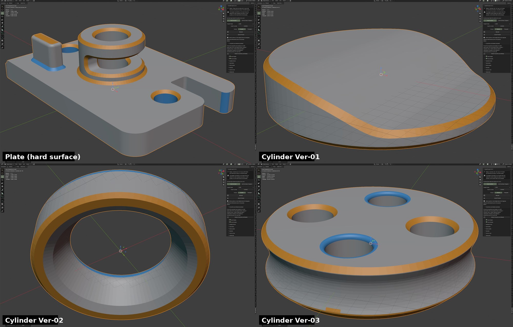

# Chamfer and bevel detector (QuadForge 0.15.x, preview; used by the 0.16 surface analysis)



*Detector output on four CAD-style STL test parts (0.15.3): orange = chamfer, blue = bevel.*

> **Status: preview.** The detector finds and paints chamfers and bevels. Since 0.16 the whole-model
> [surface analysis](SURFACE_ANALYSIS.md) builds on it, and the Hard Surface remesh can keep the sides of the bands it finds
> (experimental option *Use Surface Analysis*); the detector on its own does not change the remesh. It is written for CAD meshes (STL from Fusion 360, SolidWorks,
> FreeCAD, ...), always triangulated, mostly for 3D printing, in millimetres.

## 1. What it is for

A CAD part is made of large flat or cylindrical faces joined by small transition faces. A quad remesher that ignores
them either cuts them with a coarse quad or wastes thousands of faces on them. Before the remesher can decide
"one row of quads here, two rows there, keep this edge", something must first answer: **where are the chamfers and
bevels, how wide are they, and what kind are they?** That is the detector.

Definitions used everywhere in this project:

| Term | Meaning |
|---|---|
| **Band** | A narrow, elongated strip of faces that joins two larger surfaces and turns the surface from one to the other |
| **Chamfer** | A band that is flat (one plane, or several coplanar facets) |
| **Bevel** (fillet, round) | A band that is curved (several facets, or a smooth curve, normals change across it) |
| **Width** | Distance across the band, measured on the surface, in model units (mm for CAD) |
| **Length** | Extent along the band |
| **Turn** | Total angle the surface turns across the band (degrees) |
| **Radius** | Estimated radius of a bevel (0 for a chamfer) |
| **Convex / concave** | Outside edge of the part, or inside corner |

## 2. How to use it (user)

1. Select the mesh object. Open **N > QuadForge > Chamfers and Bevels (preview)** (the panel is closed by default).
2. Press **Detect Chamfers and Bevels**.
3. The mesh is coloured: **orange = chamfer, blue = bevel**; everything else keeps its normal look. The viewport
   switches to Solid shading with the vertex colour view so the paint is visible.
4. A table of every band (kind, convex/concave, width, length, turn, radius, face count) is written to a text
   datablock called **QuadForge Bands** (Text Editor > open it from the dropdown) and a summary appears in the status bar.
5. Each face gets an integer attribute **`qf_band`**: the band number counted from 1 (0 = no band; the engine's own `face_band` uses 0-based ids and -1). You can select by it with
   Geometry Nodes or a script.

Units: sizes are reported in millimetres. The add-on guesses millimetres per Blender unit from the scene: unit system
*None* means 1 unit = 1 mm; a unit scale other than 1 is applied (`scale * 1000`); otherwise a part whose largest
side is 2..2000 units with the scene at 1 unit = 1 m is read as millimetres (typical STL import). The message
shown after detection says which rule was used.

The original mesh is not changed (only the attribute and the colour layer are added).

## 3. How it works (engine, `forge bands`)

Source: `engine-rs/src/stages/bands.rs`. Python side: `quadforge/core/bands.py` (writes a temporary `.fmesh`, runs
`forge bands`, reads the JSON) and operator `quadforge.detect_bands` in `operators.py`.

1. **Weld and triangulate.** Vertices at the same position are merged (STL has none shared); every polygon is cut into
   triangles that remember their owner polygon.
2. **Adjacency and dihedral angles** between neighbouring triangles. Edges at or above `sharp` degrees (default 25) are
   *sharp edges*; they separate regions and are never crossed.
3. **Curvature per face (kappa).** Across the non-sharp edges the normal change per unit length is measured
   (dihedral angle divided by the distance between unfolded face centres). The surface turning axis of each face
   (`n_f x n_g` across its highest-kappa edge) is stored; a face where a second edge turns about a different axis is
   flagged as a *corner*.
4. **Curved class.** Faces with kappa at or above `curved_factor / max_width` are curved (hysteresis: neighbours above a
   lower fraction join); small closing only through thin triangles so large flat triangles are not pulled in.
5. **Regions.** Faces grow into regions across non-sharp edges when they have the same class and, for curved faces,
   the same corner flag and a compatible turning axis (|dot| >= 0.766, about 40 degrees). Corner patches are kept apart.
6. **Candidates.** Regions with elongation (length / width) >= 2 and `min_width <= width <= max_width`.
7. **Clusters.** Side-by-side strips whose normals across the shared edge differ by at most `link` degrees (default
   35) are one band (a chamfer next to a flat land, a bevel made of several facets).
8. **Measurement.** Width, length, turn, radius and convexity per cluster, from the outer boundary ridge pairs.
   Convexity comes from how the two outer neighbours diverge (geometric, independent of triangle orientation).
9. **Rejection rules.** Too short (< 1.5 x max width), wider than 0.35 x the size of its smaller neighbour, or turn
   outside [8, 135] degrees: not a band.
10. **Completion.** Leftover curved or corner triangles inherit a neighbouring band (up to 6 passes), then touching
    bands of the same kind and convexity, with similar width (ratio <= 1.25) and turn (difference <= 12 degrees), are merged.

**Multi-scale search.** With no explicit `--max-width` the widest band is 4 % of the bounding-box diagonal times
1.0, 1.4, 2.0 and 2.8. The finest scale wins; a coarser scale only adds a band if at most 25 % of its faces are
already taken, and scales above 1 require a turn of at least 20 degrees (to avoid wide false bands on gentle surfaces).
`--max-width` runs one scale only. **`min_width`** defaults to 0.3 % of the diagonal: a 0.05 mm land is not a band.

## 4. Command line

```
forge bands --in part.fmesh [--json out.json] [--sharp 25] [--curved F] [--narrow 0.35]
            [--max-width W] [--min-width W] [--link 35] [--elong 2]
```

Writes the report to `--json` (with the per-face list) and prints `B <json>` (without per-face data) then `OK` on
standard output, following the engine protocol (`P`, `R`, `S`, `OK`, `ERR`). Exit code 2 on read error.
Widths are in the units of the input file. Convert an STL to `.fmesh` with the helpers in `tools/` (`stlio.py`, `fmesh.py`).

## 5. JSON report

```json
{ "regions": 41, "ref_width": 1.52,
  "bands": [ {"id":0, "kind":"chamfer", "convex":true, "faces":86, "facets":1, "area":38.2,
              "width":1.5, "length":22.0, "turn":45.0, "curvature":0.0, "radius":0.0} ],
  "face_band": [0, 0, -1, 1, ...] }
```

`face_band[i]` is the band id of input polygon `i` (-1 = none). `kind` is `"chamfer"` or `"bevel"`. `facets` = number
of distinct planar facets in the band; `curvature` = normal spread inside the band in degrees (about 0 for a chamfer).

## 6. Debug switches

| Variable | Effect |
|---|---|
| `FORGE_BANDS_DEBUG=1` | Prints why each cluster was rejected and adds `face_region`, `face_kappa`, `regions_info` to the JSON |
| `FORGE_DBG=1` | One line per region (area, length, width, elongation, candidate flag, normal) |

## 7. Tests

- `cargo test --release` in `engine-rs/` (engine unit tests).
- Regression set used during development: four real CAD parts (cylinder plate at 120K, two plates, a flange) plus
  synthetic posts with chamfers and fillets (band counts must stay stable: 13, 4, 2, 18 on the four real parts).
- Blender: the operator is run headless against the same parts (`bpy`) and checked for the `qf_band` attribute and the text table.

## 8. Known limits

- Coarse fillets made of very few big facets (for example 3 facets of 30 degrees) are not detected.
- Fillets made of many very thin facets (typical of the top of a post exported with fine tessellation) and rounded
  vertical corners of posts are only partly detected.
- A few false bands may appear on strips between flat faces (for example "chamfer, concave, width 0.9, turn 25").
- Consistent triangle orientation is assumed.
- The Windows and macOS engines checked into the repository are older builds without `bands` and `surfaces`; the release workflow builds current ones for every platform. Until you install a release built by CI, detection only works with the Linux engine (the operator reports an error on the other systems).

## 9. Roadmap

1. Done: 0.15.5 removes bands inside curved walls; 0.16 turns the bands into surfaces and lets the remesher keep their sides (experimental).
2. Next: tune on more CAD exports (Fusion 360, SolidWorks, FreeCAD); thin-facet fillets; quad rows that follow the band width (one or two rows depending on width versus cell size), bevel density by radius.
3. Release builds for Windows and macOS that include the detector.
